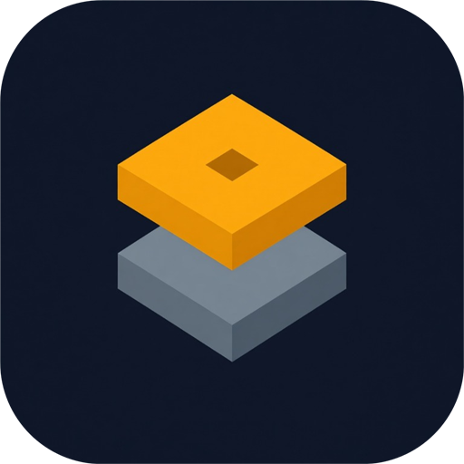
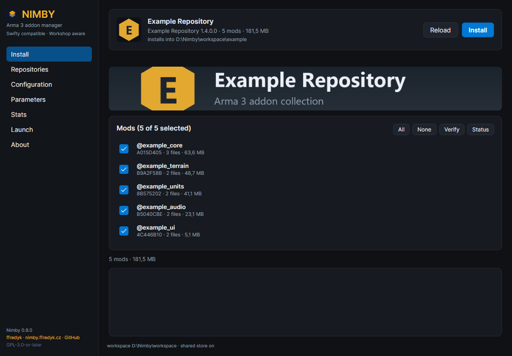
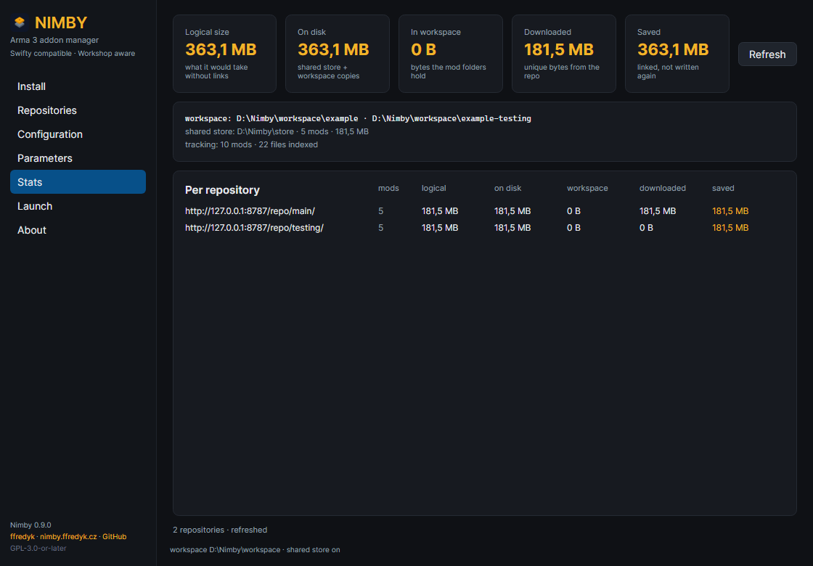

<p align="center">
  
</p>

<h1 align="center">Nimby</h1>

<p align="center"><strong>Arma 3 addon manager for Swifty repositories — Workshop aware, link first, portable.</strong></p>

<p align="center">
  <a href="https://github.com/ffredyk/nimby/releases"></a>
  
  
  <a href="https://nimby.ffredyk.cz"></a>
</p>

---

Nimby installs Arma 3 mods from existing [Swifty](https://www.getswifty.net/) repositories, but it
never downloads a byte it can get locally: content that already sits in your Steam Workshop cache or
in a shared mod store is hardlinked into the workspace instead of being copied. Everything else is
fetched with parallel chunked transfers, verified byte for byte against the repository manifest, and
recorded in a per-file tracking index so updates are a stat call instead of a full rehash.

- **Drop-in for Swifty repos.** Same `repo.json` + `mod.srf` format (v3 JSON *and* the legacy text
  format), same checksum chain. Your community's repository works unchanged.
- **Reuses the Workshop.** 70 % of the mods in a typical Arma repo carry a `publishedid`; a full
  match becomes a junction, a partial match an overlay of hardlinks plus the missing files.
- **Shared store.** Download once into one folder, hardlink into as many repositories/workspaces as
  you like.
- **Portable.** One zip, no installer, no registry. Configuration and the hash cache live in `data\`
  next to the executable.
- **Byte-exact progress.** Per-mod bars, transfer rate, ETA, live cancel with resume.

| | |
|---|---|
|  |  |
| *Install: per-mod progress, live rate and ETA* | *Stats: what is on disk, what was saved* |

## Download and run

1. Grab `nimby-0.9.0-win-x64.zip` from [Releases](https://github.com/ffredyk/nimby/releases) and
   check it against `SHA256SUMS.txt`.
2. Extract it anywhere you can write — for example `C:\Games\Nimby` or a USB stick.
3. Run `Nimby.exe`. Nothing is installed, nothing is written outside that folder unless you ask for it.

The zip contains `Nimby.exe` (GUI), `bin\nimby.exe` (the CLI the GUI drives, same version — keep it
there), `data\` (your portable configuration), the brand assets, the licence/notices and the docs.
Add the `bin` folder to `PATH` if you want to call `nimby` from a terminal; the CLI started from there
uses the same `data\config.json` as the GUI.

> The build is not code-signed, so Windows SmartScreen may warn on first launch. Verify the SHA-256
> of the zip instead of trusting the download.

**Requirements:** Windows 10/11 x64, Arma 3 (Steam). Nothing else — the .NET runtime is bundled.

## First run in five minutes

1. **Repositories** → paste your community repository URL → *Add*. It becomes the active repo.
2. **Configuration** → point *Workspace root* at a folder (for example `E:\Nimby`). Every repository
   gets its own subfolder there, so repos never mix.
3. Optional: enable the **shared store** (`E:\Nimby\shared`) to keep each downloaded file once.
4. **Install** → tick the mods you want → *Install*. Workshop content is linked, the rest is
   downloaded; the bar shows real bytes, the current rate and the time left.
5. **Launch** → pick a server from the repository, or just press *Launch* to start Arma with `-mod=`.

The full walk-through, with screenshots and troubleshooting, is in [docs/TUTORIAL.md](docs/TUTORIAL.md).

## How it saves disk and time

For every file in the manifest Nimby looks for an identical file (size, then MD5 of the parts) in the
Steam Workshop cache and in the shared store. Only what is missing is fetched.

| Mode | When | Result | Extra disk |
|---|---|---|---|
| `dir-link` | every file matches a Workshop item or the store | junction/symlink the `@mod` folder | 0 |
| `overlay` | some files match | hardlinks for those, fetch the rest | only the rest |
| `copy` | links are impossible (exFAT, network share) | copies bytes | full |
| `passthrough` | opt-in | launch straight from the source folder | 0 |

Windows junctions and hardlinks need no administrator rights. Symlinks are the fallback, copy is the
last resort.

Measured on a real repo (`@cba_ws`, `@cba_rf`, `@pulau`, cold cache):

| approach | wall time |
|---|---|
| one request per manifest part, sequential | 78 s |
| 8 MiB chunks, 4 workers per file, adaptive file parallelism | **8.4 s** |

Mods are also installed in parallel (`parallelMods`, default 2): on 138 MB across five mods, 6.2 s
one-by-one vs 5.2 s with two at a time.

## What is on disk

```
E:\Nimby\                              workspace root
  Example-Repo\                        one repository, fully isolated
    @cba_ws\                           mod folder (hardlinks / junction)
    .nimby\<mod>.json                  provenance: repo, checksum, mode, sources
    .nimby\tracking.json               per-file index (origin, location, size+mtime)
  shared\                              optional shared store, one copy per file
%APPDATA%\Nimby\config.json             config when running non-portable
```

`tracking.json` records, for every installed file, whether the bytes came from the repository
(`download`), the Workshop (`workshop`) or the shared store (`store`), where they physically live,
the link kind, the expected checksum and a size+mtime signature. That powers an exact Stats page and
`nimby update --check`, which answers in milliseconds because it only stats files; `--deep` hashes
them when you want certainty.

## Command line

The GUI is a thin client over the same CLI, so anything the UI does can be scripted.

```powershell
nimby doctor                                  # environment: Steam, Arma, links, store
nimby repo add <url> --name "Community" --select
nimby repo folder <url> [folder|--default]    # subfolder under the workspace root
nimby install                                 # active repo, configured workspace
nimby install --mods "@cba,@ace" --parallel 12 --mod-parallel 3
nimby install --optional "@jsrs" --no-required
nimby update --check                          # quick: index vs repo.json
nimby update --check --deep                   # hash everything, catch drift
nimby repair                                  # reinstall what no longer matches
nimby track [--verify] [--rebuild]            # inspect / backfill the tracking index
nimby stats [--json]                          # bytes on disk, saved, downloaded
nimby launch --server Contracts --dry-run
nimby migrate                                 # import a Swifty installation's settings
nimby migrate --layout                        # move root-level mods into the repo subfolder
```

Every command accepts `--json`. `nimby install --progress json` streams one event per line
(`resolving`, `plan`, `modStart`, `fileStart`, `fileProgress`, `file`, `modDone`, `retry`, `resumed`,
`needsAction`, `skipped`, `cancelled`, `failed`, `done`) including `speed`, `etaSeconds` and exact
byte counts, which is exactly what the GUI renders.

Cancelling is cooperative — the current 8 MiB chunk finishes, everything verified stays on disk, and
the next run resumes from it (measured: cancel at 6 % of a 476 MB mod, the re-run moved 39 MB instead
of 476 MB). Transient failures retry with backoff; permanent ones ask the user (`--on-error ask`)
over a stdin control channel, with the taskbar flashing in the GUI.

## Migrating from Swifty

`nimby migrate` reads the Swifty client's `Settings.json` and imports the Arma path, the scratch
folder, the workspace root, the repositories and the launch parameters. `nimby migrate --layout`
moves mods that were installed directly in the workspace root into the active repository's subfolder
with renames only, so hardlinks and the shared store survive.

## Building from source

Prerequisites: Rust (stable), .NET 10 SDK, and either MSVC build tools or MinGW-w64 (needed for the
C parts of `ring`; `scripts/build.ps1` finds it or takes `NIMBY_MINGW`).

```powershell
powershell -File scripts\build.ps1 test            # 90 tests
powershell -File scripts\build.ps1 clippy --all-targets -- -D warnings
powershell -File scripts\build.ps1 build --release
dotnet build gui\Nimby.App -c Release
powershell -File scripts\package.ps1               # dist\nimby-<version>-win-x64.zip
```

The GUI has a headless self-check used by CI: `NIMBY_SMOKE=1` (pages), `=save` (settings round-trip),
`NIMBY_SMOKE_INSTALL=1` (real install), `NIMBY_SMOKE_CANCEL=1` (cancel + resume). See
[CONTRIBUTING.md](CONTRIBUTING.md).

## Technical notes

- `docs/FORMAT.md` — the repository format as reverse-engineered from the Swifty client and the live
  CDN: `repo.json`, `mod.srf` v3/legacy, the MD5 checksum chain, PBO headers.
- Checksums are verified per part, then per file, then for the whole mod; `nimby verify` reproduces
  the repository's own mod checksums (`@cba_ws` → `DD39F3C34318C8CB5950E0B785FBCB08`).
- Hashes are cached by path, size and mtime in `%APPDATA%\Nimby\hashcache.json` (or `data\` in the
  portable build), so warm runs skip rehashing.

## Licence and credits

Nimby is free software under the **GNU General Public License v3.0 or later**. The complete
corresponding source of every released binary is this repository; see [LICENSE](LICENSE) and
[NOTICE](NOTICE).

Attribution is a licence condition, not a request: the **additional terms under GPL-3.0
section 7(b)** in [LICENSE-ADDITIONAL-TERMS.md](LICENSE-ADDITIONAL-TERMS.md) require every
derivative to keep the copyright notice, the credit **ffredyk** and a link to
[github.com/ffredyk/nimby](https://github.com/ffredyk/nimby) in its About/Credits screen, its
version or about command output, its documentation and the source files it modifies.

The name "Nimby", the app icon and the ffredyk mark are brand assets and are **not** covered by the
GPL — they may be used to refer to unmodified Nimby builds only. Third-party components (Avalonia,
.NET, the Rust crates) are listed in [THIRD-PARTY-NOTICES.md](THIRD-PARTY-NOTICES.md), with the
licence texts in [LICENSES](LICENSES).

Contributions are welcome — read [CONTRIBUTING.md](CONTRIBUTING.md) first. Security problems go
through [SECURITY.md](SECURITY.md), never a public issue.

<p align="center">
  <br>
  <sub>Made by <a href="https://nimby.ffredyk.cz">ffredyk</a> · not affiliated with Bohemia Interactive or Steam</sub>
</p>
