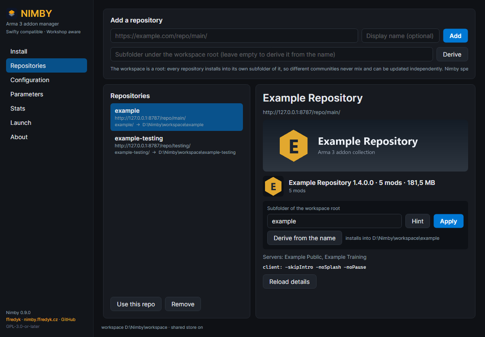
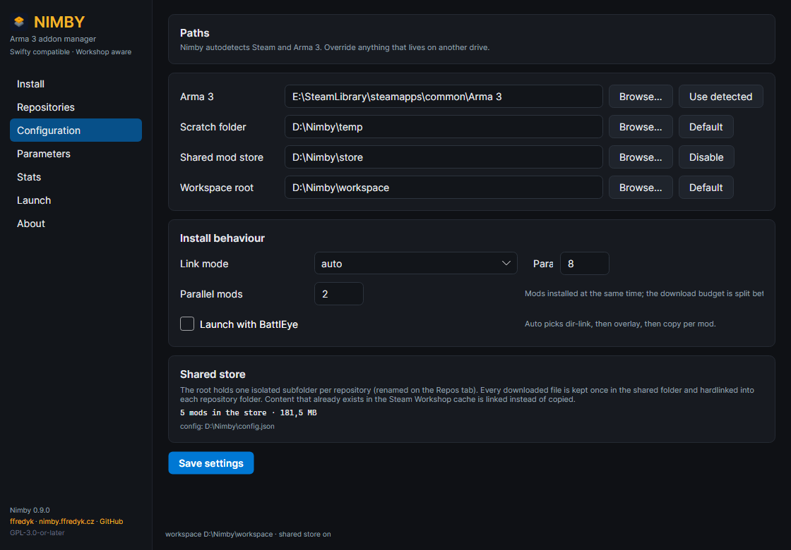
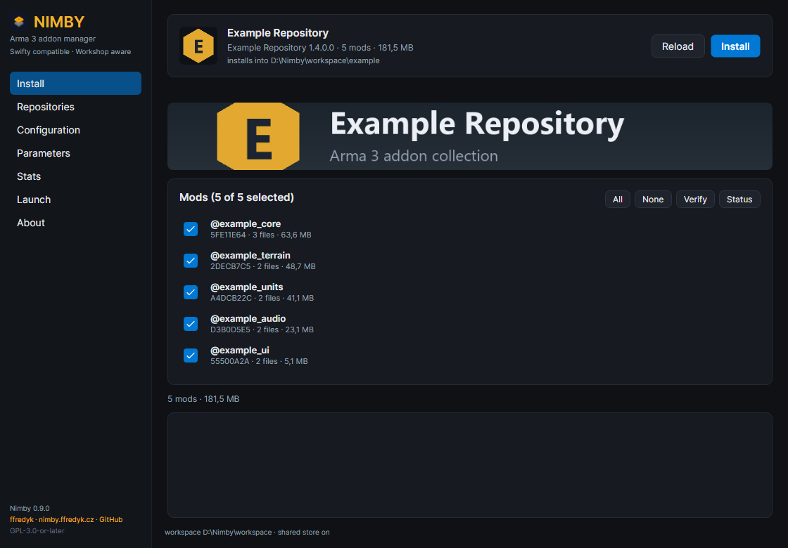
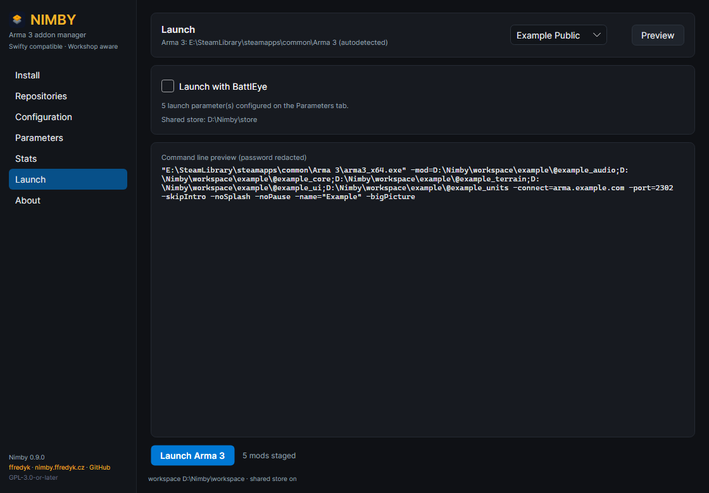
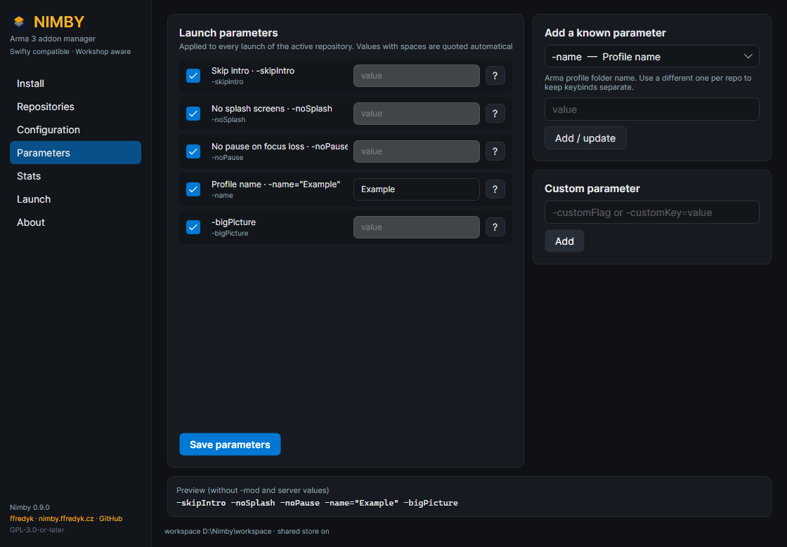
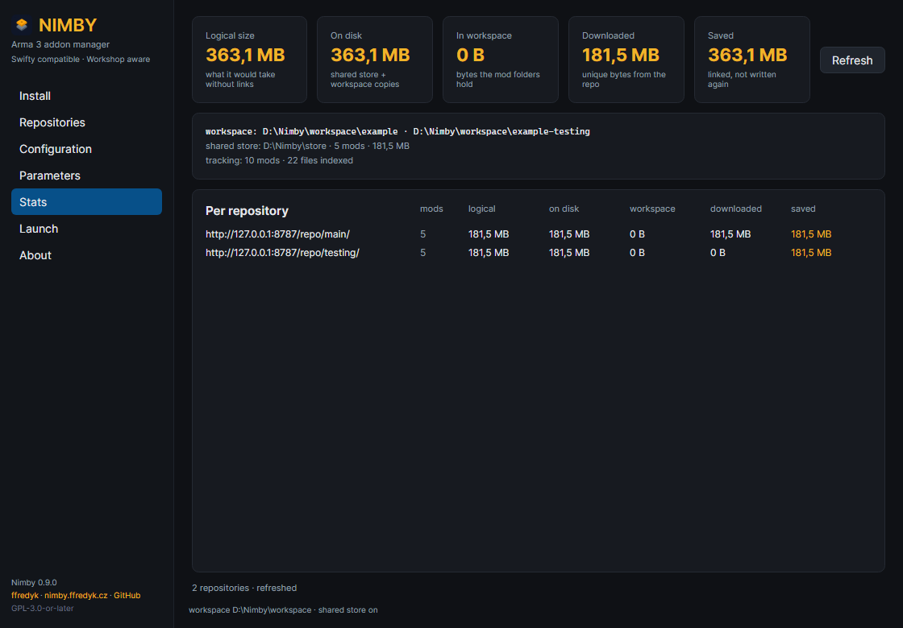
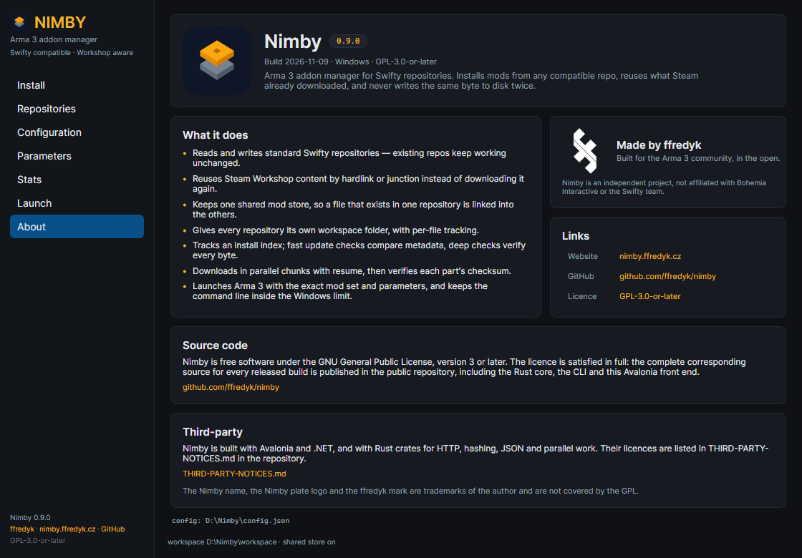

# Nimby 0.9.0 — end-user guide

Nimby installs Arma 3 mods from a community repository. It looks for each file in
your Steam Workshop cache and in an optional shared store first, links what it finds
instead of downloading it, verifies the rest byte for byte, and records what it
installed so later checks take a second. This guide is for players: it assumes Arma 3
on Steam and the URL of a Swifty-compatible repository, and every click has a
command-line equivalent.

## 1. What you need

Windows 10 or 11 (64-bit), Arma 3 on Steam, and the portable zip
`nimby-0.9.0-win-x64.zip` from the
[releases page](https://github.com/ffredyk/nimby/releases).

There is no installer, no registry entry and no administrator prompt. The .NET
runtime is bundled, so you do not install .NET either. Nimby writes only to the folders
you point it at, its own configuration folder and the scratch folder.

The build is **not code-signed**, so SmartScreen may warn on first launch. Check the
download instead of trusting it; `SHA256SUMS.txt` is published next to the zip:

```powershell
$zip = "nimby-0.9.0-win-x64.zip"
$expected = ((Get-Content .\SHA256SUMS.txt) -match [regex]::Escape($zip))[0].Split()[0]
(Get-FileHash .\$zip -Algorithm SHA256).Hash.ToLowerInvariant() -eq $expected.ToLowerInvariant()
```

The last line prints `True` when the file is intact. Only then extract it, and only
then click past SmartScreen.

## 2. Install the app

1. Extract the zip anywhere you can write: `C:\Games\Nimby`, a second drive, a USB
   stick.
2. Run `Nimby.exe` from that folder.
3. The first launch creates `data\config.json` next to the executable.

| Item | What it is |
|---|---|
| `Nimby.exe` | The window you use. |
| `bin\nimby.exe` | The command-line tool the GUI drives for every action. |
| `data\` | Portable configuration; holds the hash cache too. |
| `assets\branding\` | Logos and marks, also used by the About page. |
| `docs\` | This tutorial, the repository format notes, the screenshots. |
| `LICENSES\` | Licence texts of the third-party components. |
| `README.md`, `CHANGELOG.md` | Project summary and release notes. |
| `LICENSE`, `NOTICE`, `THIRD-PARTY-NOTICES.md` | Licence and attribution. |

Keep `Nimby.exe` and `bin\nimby.exe` together — the CLI sits in `bin` because Windows
cannot hold both `Nimby.exe` and `nimby.exe` in one folder. The GUI looks for
`bin\nimby.exe`, then `nimby.exe` next to itself, then on `PATH`; if it is missing or
from another version the window cannot do anything useful. Always move or copy the
whole folder.

`data\` is what makes the install portable: settings, repositories and the hash cache
travel with the folder. Nimby probes the folder with a real write, so if you extract
somewhere read-only such as `C:\Program Files` it falls back to
`%APPDATA%\Nimby\config.json` automatically. Both work; only the portable one survives
copying the folder to another machine.

To uninstall, close Nimby and delete the folder, plus `%APPDATA%\Nimby` if you used the
fallback.

## 3. Add your community repository

A repository is a web folder that contains `repo.json`. Your community publishes its
URL; it must point at that folder, not at the website in general.

1. Open **Repositories**.
2. Paste the URL into the first field.
3. Optionally type a display name. It is only a label, but it also seeds the folder
   name.
4. Optionally type a subfolder name, or leave it empty to derive one.
5. Press **Add**. The repository becomes the active one.



*The Repositories page: add form on top, the list on the left, details on the right.*

**One repository, one folder.** The workspace root is a container, not an install
target: every repository installs into its own subfolder (`E:\Nimby\ExampleRepo`,
`E:\Nimby\OtherCommunity`), so two communities never mix and update independently.
Names are cleaned to letters, digits, `_`, `.` and `-`; anything else becomes `-`, and
two repositories never share a folder: the second one gets a `-2` suffix.

**Renaming:** select the repository, edit **Subfolder of the workspace root**, press
**Apply**; **Derive from the name** restores the automatic name. A rename only changes
where the next install and launch look. Existing mods stay in the old folder, so
rename before the first install or move the folder in File Explorer afterwards.

**Active** means "the repository the other pages talk about". Install, Launch, Verify
and Status act on the active repository; Update, Stats and Repair cover every
configured repository. The active entry carries a `*` in `nimby repo list`, and **Use
this repo** switches it.

The details panel shows the repository's artwork (`repo.png` banner, `icon.png` icon),
version, mod count and size, the server list and the client parameters it asks for.
**Reload details** re-reads them; artwork is cached under `%APPDATA%\Nimby\images`.
**Remove** forgets the repository and never deletes installed mods.

For scripts:

```powershell
nimby repo add "https://example.com/repo/main/" --name "Community" --folder Community --select
nimby repo list
nimby repo folder "https://example.com/repo/main/" Community
nimby repo select "https://example.com/repo/main/"
```

## 4. Configure paths



*The Configuration page: paths on top, install behaviour and the store summary below.*

1. **Arma 3.** Steam libraries are scanned automatically (registry, then
   `libraryfolders.vdf`) and `<library>\steamapps\common\Arma 3` is used when found;
   otherwise press **Browse…**. **Use detected** fills in the detected path; a folder
   is accepted when it holds `arma3_x64.exe` or `arma3.exe`.
2. **Scratch folder.** Partial downloads; default `%TEMP%\nimby`, best on a fast local
   disk.
3. **Workspace root.** The container from section 3; default
   `%LOCALAPPDATA%\Nimby\mods`. Pick a drive with room and keep the path short — a
   shorter root means a shorter `-mod=` command line (section 7).
4. **Shared mod store.** Optional. Every downloaded file is kept once under
   `<store>\@mod\…` and hardlinked into each repository folder, so a second repository
   that uses the same mod downloads nothing. With one repository it buys nothing; keep
   it on the same drive as the workspace root so files can be hardlinked.
5. Press **Save settings**; the configuration file in use is shown at the bottom.

**Link mode** decides how files reach the mod folder. `auto`, the default, chooses per
mod: when every file already exists byte-identical in the Workshop cache or the store,
the whole `@mod` folder is linked in one step; otherwise matching files are linked and
only the missing ones are downloaded. Alternatives: `dir-link` (link only, otherwise
download), `overlay` (always link per file), `copy` (never link) and `passthrough` (do
not materialize, launch from the source folder). **Parallel** (default 8, 1–32) is the
concurrent file transfers per mod; **parallel mods** (default 2, 1–16) is how many mods
install at once. The two values multiply, so the budget is shared between active mods.

**Launch with BattlEye** sets the default for launches and selects `arma3battleye.exe`.
The Launch page can enable it for a single launch without changing the setting.

## 5. Install mods



*The Install page: repository header, overall bar, one row per mod and the log.*

The repository marks mods as required or optional; optional rows carry a `· optional`
note. Everything the repository enables is ticked when the page loads; **All** and
**None** change the selection. **Install** installs exactly what is ticked — required
mods as one list, optional mods as another, and if you tick no required mod Nimby is
told not to add them behind your back.

Each row has a bar, a file counter (`42% · 120/300 files`) and a status text:

| Status text | Meaning |
|---|---|
| `queued` | Selected, waiting for a worker. |
| `fetching <file>` | A part of that file is arriving. |
| `<file> · 12.4 MB/s` | Transfer in progress, with the live rate. |
| `downloaded <file>` | The file came over the network. |
| `linked from Workshop <file>` | Hardlinked or junctioned from the Steam cache; no bandwidth. |
| `linked from shared store <file>` | Hardlinked from the shared store. |
| `copied <file>` | Copied because the link mode is `copy`. |
| `reuse <file>` | Kept from an interrupted run after verification. |
| `kept N file(s) from the previous run` | Resume found work it could trust. |
| `retrying 2/3` | Transient failure; Nimby backs off and tries again. |
| `dir-link · saved 320 MB` | Finished, plus what was linked instead of written. |
| `needs your decision`, `skipped`, `cancelled`, `failed: …` | See below. |

The overall bar shows `Installing 2/5 · @ace`, a percentage, the current file, and a
line like `1.2 GB / 3.4 GB · 120/300 files · 4 in parallel · 12.4 MB/s · ~1m 5s left`.
The rate counts bytes that actually cross the network, so linking a Workshop mod does
not inflate it; the estimate appears once there is a rate to base it on. **Saved**
means bytes that already existed elsewhere and were linked instead of downloaded or
copied — not a download counter.

### Cancelling and resuming

**Cancel** appears only while an install runs. Cancelling is cooperative: the file
being written finishes its current chunk, everything already verified stays on disk,
and the command exits with code 3 (`Cancelled. Install again to resume — finished
files are kept.`). Press **Install** again: Nimby verifies what is left behind, keeps
the files that match, logs `kept N file(s) from the previous run (x MB)` and downloads
only the rest.

### When something cannot be installed

Transient problems (timeouts, dropped connections, interrupted transfers) retry
automatically with a growing delay; the row shows `retrying 1/3`.

A problem that will not go away stops that mod and shows the decision panel: yellow
border, `@mod needs a decision`, the reason (repository unreachable, corrupt download,
refused disk write, a file the repository does not offer, or the raw message) and
three buttons:

- **Retry** — try this mod again.
- **Skip mod** — leave it and continue. The run ends with exit code 4 and the log
  lists what was skipped.
- **Stop** — stop the whole run.

While the panel waits the taskbar button flashes, so you notice it even behind Arma.
Nothing is lost either way: finished files are kept and a later run resumes. The log
panel at the bottom keeps the last 300 lines of CLI output.

## 6. Verify, update, repair

Two buttons sit next to the selection tools on the Install page:

- **Verify** hashes the selected mods against the manifest recorded in `.nimby`,
  offline, and reports `All selected mods verified.` or `N mod(s) need repair.`
- **Status** runs `nimby status` for the active folder: one line per mod with its name,
  mode (`dir-link`, `overlay`, `copy`, `passthrough`, or `incomplete` when the last run
  did not finish), whether the folder is a link or real files, and the checksum.

Update checks every configured repository, not only the active one:

```powershell
nimby update --check
nimby update --check --deep
nimby update
```

`--check` only reports; without it Nimby reinstalls what it found out of date. The
quick check compares `repo.json` with the tracking index — a size and modification time
per file, no hashing — so it answers in milliseconds. `--deep` hashes everything,
which catches content that changed without the metadata changing.

| State | Meaning | Fix |
|---|---|---|
| `up_to_date` | Nothing changed. | — |
| `outdated` | The repository ships a different mod checksum. | `nimby update` |
| `drifted` | The repository is unchanged but files on disk no longer match the recorded size, time or hash. | `nimby repair` |
| `missing` | A manifest file is gone. | `nimby repair` |
| `untracked` | Installed before the tracking index existed. | Reinstall from Nimby |

**Drift is normal.** Steam updates a Workshop item that Nimby linked in, so the link
now points at newer bytes; `nimby update --check` reports `drifted` and `nimby repair`
reinstalls the affected files. Repair verifies every installed mod using the hash cache
and needs the repository recorded in `.nimby`, so it repairs mods Nimby installed and
leaves unknown folders alone.

Why it is fast: `.nimby\tracking.json` stores, per file, origin, location, checksum and
a size-plus-mtime signature. The quick check is one `stat` per file plus one
`repo.json`; a deep check reuses the hash cache; verify falls back to the manifest in
`.nimby` even for a linked mod whose folder belongs to Steam.

## 7. Launch



*The Launch page: server picker, BattlEye and the exact command line.*

1. Pick a server, or leave **No server**. The list comes from `repo.json`; the first
   entry is preselected.
2. Tick **Launch with BattlEye** if the server requires it; this selects
   `arma3battleye.exe`.
3. **Preview** shows the exact command line with the password redacted.
4. **Launch Arma 3** starts the game; Nimby waits until it exits.

Launch passes every mod folder in the active workspace with `-mod=`, plus the server
address, port and password, the Parameters page entries and the repository's client
parameters. If Arma is already running the launch is refused.

### Parameters page



*The Parameters page: the list, the known-parameter picker and the preview.*

Parameters apply to every launch Nimby performs. **Managed** ones (`-mod`,
`-connect`, `-port`, `-password`) are filled in from the installed mods and the server
picker; **user** ones are yours, picked from the known list or typed as `-flag` or
`-key=value`. Values with spaces are quoted automatically, and the profile name is
**always** quoted: `-name="Fred"`. Uncheck a parameter and press **Save parameters** to
remove it; the preview shows the rendering without `-mod` and server values.

### The command-line length limit

Windows caps a command line at 8191 characters, and `-mod=` with absolute paths eats
that fast. Nimby measures the line and refuses to launch (`command line would be 8632
characters (limit 8191) with 24 mods; …`) instead of letting Arma fail cryptically.
Fixes: move the workspace root closer to the drive root (`E:\Nimby`, not
`E:\Games\Arma Stuff\Nimby\Workspace`), split unrelated mods across repositories, drop
mods you do not need for that server.

## 8. Stats



*The Stats page: the byte counts, store and tracking lines, one row per repository.*

| Card | Meaning |
|---|---|
| **Logical size** | What the mods would take with no links at all. |
| **On disk** | Logical size minus Workshop bytes: store payload plus bytes the workspace really holds. |
| **In workspace** | Bytes that exist only inside the workspace folders. |
| **Downloaded** | Bytes fetched from the repository, counted once wherever they ended up. |
| **Saved** | Bytes linked from the Workshop cache or the store instead of written again. |

Workshop content belongs to Steam and is never counted as Nimby's disk use. The shared
store is measured from the store folder itself — one physical copy per file however
many repositories link it — while each repository row shows the store bytes that
repository uses. The tracking line reads `tracking: 12 mods · 4 318 files indexed`, or
`tracking: none yet (install or repair to backfill)`. From a terminal: `nimby stats`,
or `nimby stats --json`.

## 9. Coming from Swifty

Nimby imports an existing Swifty installation instead of asking you to retype it: close
the old client, preview, then apply.

```powershell
nimby migrate --dry-run
nimby migrate
```

It reads `%APPDATA%\Swifty\Settings.json` and imports the Arma 3 path (only if it still
holds an Arma executable), the scratch folder, the parallel download count, every
repository with URL, name and stored credentials, the workspace root taken from the
first repository's path, and that repository's launch parameters.

It does not delete, move or modify anything in the old client, and its repositories
stay where they are. Use `--source "<path>\Settings.json"` if the file lives elsewhere.
After importing, open **Repositories** and press **Use this repo** on your community —
the active repository is what Install and Launch act on.

**Old installs at the root.** Swifty put mods directly in its install folder while
Nimby uses a subfolder per repository. `nimby migrate --layout` moves the `@mod` folders
(and `.nimby` metadata) into the active repository's subfolder. It only renames entries,
so hardlinks and junctions survive and no byte is copied; existing names are skipped.

```powershell
nimby migrate --layout --dry-run
nimby migrate --layout
```

## 10. Command line crash course

`bin\nimby.exe` shares the configuration with the GUI, so the two can be mixed freely.
Run these in PowerShell from the `bin` folder, or add that folder to `PATH`; quote any
path or URL containing spaces. Every command accepts `--json`.

```powershell
nimby install
nimby install --mods "@cba_ws,@ace" --parallel 12 --mod-parallel 3
nimby install --optional "@jsrs_soundmod" --no-required
nimby install --progress json --on-error ask --control-stdin
nimby update --check
nimby update --check --deep
nimby repair
nimby verify "E:\Nimby\Community\@cba_ws"
nimby track --rebuild
nimby store info
nimby store prune
nimby stats --json
nimby status
nimby doctor
nimby launch --server "Example Public" --dry-run
```

`nimby config`, `nimby config set`, `nimby repo …` and `nimby migrate` are shown in
sections 3, 4 and 9; `nimby inspect <url> --images` prints a repository summary.

Flags worth knowing:

| Flag | Effect |
|---|---|
| `--mods LIST` | Install these mods (comma separated, `@name`). |
| `--optional LIST` | Install these optional mods. |
| `--no-required` | Do not add the repository's required set behind your back. |
| `--parallel N` | Concurrent file transfers per mod (1–32). |
| `--mod-parallel N` | Mods installed at the same time (1–16). |
| `--on-error abort\|retry\|skip\|ask` | What to do when a mod fails after the automatic retries; `ask` needs a control channel. |
| `--control-stdin` | Read `cancel`, `retry`, `skip`, `abort` from stdin, one word per line. |
| `--progress json` | One JSON event per line (`resolving`, `plan`, `modStart`, `fileStart`, `fileProgress`, `file`, `modDone`, `retry`, `resumed`, `needsAction`, `skipped`, `cancelled`, `failed`, `done`); cannot be combined with `--json`. |
| `--json` | Print the final result as JSON. |
| `--no-workshop`, `--no-store` | Ignore the Workshop cache or the store for this run. |

Exit codes: `0` success, `1` error, `3` cancelled (finished files kept), `4` finished
with skipped mods. `nimby verify` and `nimby publish` exit with `2` when a folder does
not match its manifest.

## 11. Troubleshooting

| Symptom | Cause | Fix |
|---|---|---|
| Repositories page says `unreachable` / `Could not read repo.json from this URL.` | The URL does not point at the folder holding `repo.json`, or the host is down. | Copy the exact URL from your community, open `…/repo.json` in a browser, then **Reload details**. |
| `nimby inspect` fails with an HTTP error | Same, or the server rejects the request. | Test the URL; re-add the repository; use `--user`/`--pass` on `nimby repo add` if it needs a login. |
| `… exists and is not managed by Nimby; pass --force to replace it` | The `@mod` folder came from another client or was made by hand. | Confirm it is the same mod, then `nimby install --mods "@mod" --force`, or move the folder away. |
| Linking fails on exFAT or a network share | Those file systems cannot host the hardlinks and junctions Nimby uses. | Set link mode `copy` (`nimby config set --link-mode copy`, or `nimby install --mode copy`). Slower and it uses full disk space, but it works. |
| A mod reports `drifted` after a Steam update | The Workshop item behind the link changed. | `nimby repair`, or reinstall that mod. |
| Hashing is slow, the disk never idles | Antivirus scans every file Nimby reads. | Keep the hash cache and add the workspace root, the store and the app folder as folder exclusions in Windows Security. |
| `command line would be … characters (limit 8191)` | Too many mods or a deep workspace path. | Shorten the workspace root, split repositories, install fewer mods. |
| I cancelled by mistake — is progress lost? | No: cancel stops after the current file and keeps verified data. | Run **Install** again; the log shows what was kept. |
| I need logs | The GUI shows the last 300 lines only. | Use the log panel, or run the command with `--progress text` / `--progress json`; `nimby doctor` prints environment facts. |
| Launch is refused with "Arma 3 is already running" | A previous `arma3_x64.exe` is still alive. | Close the game and launch again. |
| Everything is misconfigured | — | Close Nimby and delete `data\config.json` (portable) or `%APPDATA%\Nimby\config.json`. Defaults come back; installed mods are untouched. |

Deleting `hashcache.json` beside the configuration file is always safe; it is rebuilt as
files are hashed again.

## 12. Where things live

```
E:\Nimby\                            workspace root (Configuration → Workspace root)
  Community\                         one subfolder per repository
    @cba_ws\                         installed mod: junction, hardlinks or real files
    @ace\
    .nimby\_cba_ws.json              provenance: repository, checksum, mode, per-file origin
    .nimby\tracking.json             per-file index: origin, location, size + mtime, checksum
  shared\                            optional shared store, one folder per mod
    @cba_ws\
      addons\…

C:\Games\Nimby\                      extracted zip
  Nimby.exe                          GUI
  bin\nimby.exe                      CLI used by the GUI
  data\config.json                   portable configuration
  data\hashcache.json                hash cache (portable install)

%APPDATA%\Nimby\config.json          configuration when the app folder is read-only
%APPDATA%\Nimby\hashcache.json       hash cache in that case
%APPDATA%\Nimby\images\              cached repo.png / icon.png per repository
%TEMP%\nimby\                        scratch folder (default)
```

`.nimby` is created per repository folder. Lock files are named after the mod with
everything outside letters, digits, `_`, `.` and `-` replaced by `_`, so `@cba_ws`
becomes `_cba_ws.json`. The lock stores the full manifest, which is why verify and
repair work for linked mods too.

## 13. Credits and licence



*The About page: version, build stamp, links and licence.*

Nimby is © 2026 ffredyk, released under the **GNU General Public License v3.0 or
later** (SPDX: `GPL-3.0-or-later`). Source for every released build is at
<https://github.com/ffredyk/nimby>; the project and downloads are at
<https://nimby.ffredyk.cz>; the licence text is at
<https://www.gnu.org/licenses/gpl-3.0.html>.

The name "Nimby", the app icon and the ffredyk mark are brand assets and are **not**
covered by the GPL; they may be used only to refer to unmodified Nimby builds.
Third-party components (Avalonia, .NET, the Rust crates) are listed in
`THIRD-PARTY-NOTICES.md`.

Nimby is an independent project, not affiliated with Bohemia Interactive, Steam or the
Swifty team.
